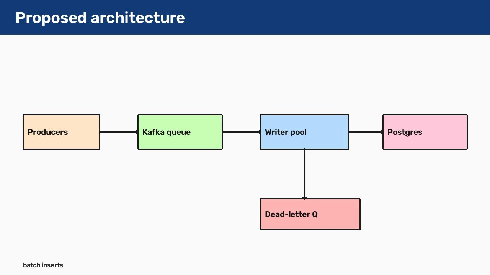
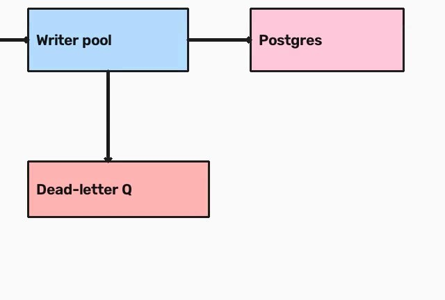
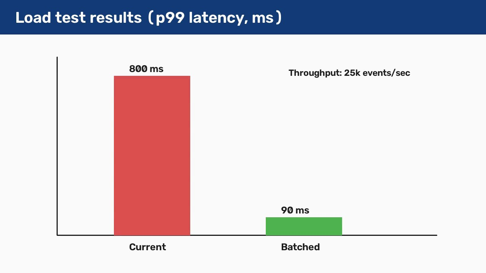

# Project Falcon - Q3 Ingestion Pipeline Redesign
**Source:** falcon_review.mp4 · **Duration:** 00:01:37 · **Participants:** Ankit (presenter), Priya, Raj, Mei

## Summary
The presenter proposed redesigning the Project Falcon ingestion pipeline. Today, events are written directly to Postgres, and the pipeline struggles at peak load: about 12,000 events/sec pushes write latency above 800 ms, and roughly 0.3% of events are lost during deploys because nothing buffers them. The proposal puts a Kafka queue between producers and a pool of writer workers that batch-insert into Postgres, with a dead-letter queue for malformed events. In load tests, batching cut p99 latency from 800 ms to 90 ms and sustained 25,000 events/sec. The team decided to stay on Postgres rather than move to ClickHouse for now. Priya will stand up the Kafka cluster by October 10 and Raj will migrate the writer service.

## Decisions
| # | Decision | Rationale | [t] |
|---|---|---|---|
| 1 | Keep Postgres as the store; do not move to ClickHouse for now | Batching through Kafka already meets latency/throughput needs | [00:01:31] |

## Action items
| Owner | Action | Due | [t] |
|---|---|---|---|
| Priya | Set up the Kafka cluster | Oct 10 | [00:01:24] |
| Raj | Migrate the writer service | - | [00:01:28] |

## 1. Problem with the current pipeline [00:00:09]
Producers write every event directly to Postgres. That causes two problems:

- **Latency at peak:** at about **12,000 events/sec**, write latency rises above **800 ms**.
- **Data loss during deploys:** about **0.3%** of events are lost while deploys run, because there is no buffer between producers and the database.

## 2. Proposed architecture [00:00:38]
Producers now publish to a **Kafka queue**. A **writer pool** consumes from the queue and **batch-inserts** into **Postgres**. While writers restart during a deploy, events wait in the queue, which removes the cause of the deploy-time loss.

*Fig 1 - Proposed pipeline: Producers → Kafka queue → Writer pool → Postgres, with a dead-letter queue off the writer pool. [00:00:46]*

When the presenter returned to the diagram [00:01:15], they pointed out that the **dead-letter queue** catches malformed events, so bad events no longer block the writers.

*Fig 2 - Detail: malformed events go from the writer pool to the dead-letter queue instead of Postgres. [00:01:15]*

## 3. Load test results [00:01:00]
| Metric | Current | Batched (proposed) |
|---|---|---|
| p99 write latency | 800 ms | 90 ms |
| Throughput | ~12k events/sec (peak observed) | 25k events/sec |

*Fig 3 - p99 latency falls from 800 ms to 90 ms with batching; throughput reaches 25k events/sec. [00:01:00]*

## Open questions
- None raised; the presenter asked for questions at [00:00:31] and nobody had any.

## Appendix: Timeline index
| Time | Topic |
|---|---|
| 00:00:00 | Introduction |
| 00:00:09 | Problem with the current pipeline |
| 00:00:38 | Proposed architecture |
| 00:01:00 | Load test results |
| 00:01:15 | Dead-letter queue |
| 00:01:23 | Next steps & decisions |
